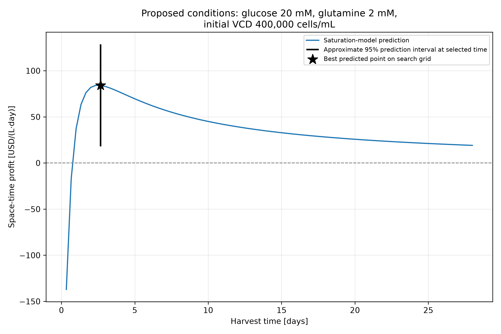
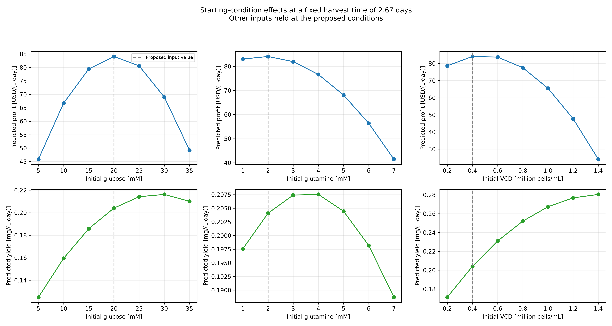

# mAb Production Optimizer

This project explores how starting culture conditions and harvest time affect the profitability of monoclonal antibody production. Using data from 30 simulated batch runs, it compares regression models and searches for conditions that maximize profit per litre per day. It also examines the trade-off between production yield and cost, estimates prediction uncertainty, and exports tables and figures to support the proposed operating conditions.

## Highlights

- Designed a batch selection covering three culture inputs.
- Compared regression models using grouped cross-validation.
- Built a saturation model with zero initial antibody.
- Evaluated harvest timing and production economics.
- Estimated prediction intervals and visualized operating trade-offs.

## Environment

The project was developed and run using the following versions:

- Python 3.14.7
- Matplotlib 3.11.0
- NumPy 2.5.2
- pandas 3.0.5
- scikit-learn 1.9.0

Python’s built-in `pathlib` and `itertools` modules are also used for file paths and generating combinations of operating conditions. 
They are included with Python and require no separate installation.

## Code Design

### Starting the Workflow

Running `main.py` starts the analysis by calling `run_workflow()` from `src/functions.py`. The main script stays short, while the supporting functions organize the work into stages for loading data, evaluating models, searching operating conditions, and exporting results.

File paths are based on the project’s location rather than the terminal’s current folder. This allows the program to find its datasets even when launched from another directory. The program also creates the `tables` and `figures` folders if they do not already exist. Running the workflow again regenerates the results from the same selected batch files.

### Loading and Checking the Data

The program reads `initial_conditions.csv` and checks that the dataset folder contains exactly the 30 selected batch files. It also confirms that each selected batch has one matching entry in the initial-conditions table.

Each batch file is checked for required columns and empty data. The program reports its number of measurements, missing values, and recorded time range. These checks help identify incomplete downloads or unexpected file formats before the analysis continues. The selected dataset contains 30 batches covering 27 unique starting-condition combinations, with additional runs at three repeated combinations.

The initial-conditions table supplies the intended starting glucose concentration, glutamine concentration, and viable cell density. These values are used to calculate culture costs because the first measurements in the batch files can differ slightly from the specified starting conditions.

### Calculating Production Economics

The program converts measurement times from hours to days so that harvest time and the one-day downtime use consistent units. It then calculates culture cost from the three starting inputs and culture value from the measured antibody concentration.

Profit is calculated by subtracting culture cost from culture value. Dividing profit by harvest time plus downtime gives space-time profit. Space-time yield uses the same cycle duration but divides antibody concentration by time without subtracting costs.

These calculations are performed at every recorded time point. The program exports the complete economic time series and identifies the highest observed space-time profit within each batch. These observed results provide a reference for evaluating the model’s harvest choices, although choosing the best measured time benefits from hindsight and measurement noise.

### Preparing and Comparing Models

The models use four inputs: initial glucose, initial glutamine, initial viable cell density, and harvest time. Their prediction target is antibody concentration. Predicted concentration is later converted into value, profit, and yield using the same economic equations as the observed data.

Model comparisons use five-fold grouped cross-validation. All measurements with identical starting conditions, including repeat batches, stay in the same group. This prevents measurements from one condition group from appearing in both training and validation within a fold.

The workflow first evaluates a mean baseline, linear regression, and degree-two polynomial regression. Scaling for the linear and polynomial models is fitted within each training fold. The program records RMSE, MAE, and R², along with training errors where applicable, to compare predictive performance.

### Checking Physical Behavior and Harvest Decisions

Overall prediction error is only part of the evaluation. The program also checks early-time predictions, negative predicted concentrations, and the economic consequences of model-selected harvest times.

For each held-out batch, it selects the recorded harvest time with the highest predicted profit. It then compares the observed profit at that time with the batch’s best recorded profit. This shows whether a model’s concentration predictions translate into useful timing decisions.

The polynomial model is retained as a comparison, but its prediction of substantial antibody at time zero conflicts with the specified initial condition. The workflow therefore also evaluates a saturation model that starts at zero and approaches a plateau. Quadratic terms describe the effects of the starting conditions, while a time-dependent factor describes the rise in antibody concentration. Fifteen combinations of time-scale and curve-shape settings are compared using the same validation folds.

### Searching Operating Conditions

The saturation configuration with the lowest mean validation RMSE is fitted on all selected batch data. The program then evaluates 343 starting-condition combinations at 84 positive harvest times, giving 28,812 candidates.

For each candidate, the predicted antibody concentration is converted into culture value, space-time profit, and space-time yield. Candidates with negative predicted concentrations are excluded from recommendations. The remaining candidates are ranked by predicted space-time profit.

This search identifies the best candidate on the evaluated grid. It does not establish a continuous global optimum or confirm the performance of unmeasured conditions.

### Estimating Uncertainty and Exporting Results

Approximate prediction intervals are calculated using held-out concentration errors at the proposed harvest time. One error is taken from each batch. The 2.5th and 97.5th percentiles are added to the candidate’s predicted concentration, then converted into intervals for culture value, profit, and yield.

These empirical intervals provide an indication of uncertainty, but their coverage at the recommended conditions has not been independently verified. They rely on errors from other starting conditions being relevant and do not fully account for model selection or optimization.

Finally, the workflow exports comparison tables, validation results, candidate rankings, and a recommendation summary. Figures show the proposed harvest curve and how changing each starting input affects profit and yield while the other inputs remain fixed. Together, these outputs provide the evidence used to explain the proposed conditions and their limitations.

## Analysis

### Choosing the 30 Batch Runs

The batch selection was designed to cover a broad range of starting conditions within a limited number of runs. Three levels were selected for each input: 5, 20, and 35 mM glucose; 1, 4, and 7 mM glutamine; and 200,000, 800,000, and 1,400,000 cells/mL initial viable cell density. Using every combination produced 27 distinct starting conditions.

The remaining three runs repeated the combinations where all inputs were low, all were at their middle levels, and all were high. These repeats provided some information about variation between batches at the same starting conditions. However, three repeat pairs are not enough to describe variability throughout the full operating range.

The selection was made using the initial-conditions table before examining production outcomes. This avoided selecting only batches that appeared profitable. Including low, middle, and high levels also provided information for fitting curved responses and interactions between inputs. The main compromise was limited sampling between these levels: predictions at intermediate conditions remain estimates that require experimental confirmation.

### Comparing the Models

The models predicted antibody concentration from the three starting conditions and harvest time. Predicting concentration allowed the same model to support calculations of culture value, space-time profit, and space-time yield.

The comparison began with a mean baseline, followed by linear regression and degree-two polynomial regression. All models used the same five grouped validation folds. Measurements and repeat batches with identical starting conditions stayed together, so each validation fold contained condition groups excluded from that fold’s model fitting.

| Model | Mean validation RMSE [mg/L] | Mean validation MAE [mg/L] | Mean validation R² |
|---|---:|---:|---:|
| Mean baseline | 0.3850 | 0.3381 | -0.1150 |
| Linear regression | 0.2052 | 0.1545 | 0.6758 |
| Degree-two polynomial | 0.1160 | 0.0820 | 0.8970 |
| Selected saturation model | 0.0837 | 0.0663 | 0.9469 |

[Full model comparison](tables/model_comparison.csv)

Linear regression substantially improved on the baseline, showing that the inputs contained useful predictive information. Polynomial regression reduced the error further by allowing curved responses and interactions.

However, inspecting its predictions revealed a problem that the overall scores did not show clearly. At its proposed operating conditions, the polynomial predicted approximately 0.587 mg/L antibody at time zero, despite the specified initial concentration being zero. This made its early production and harvest predictions difficult to justify physically.

### Why the Saturation Model Was Selected

The saturation model combines a quadratic relationship for the starting conditions with a time-dependent factor:


$$
\widehat{\mathrm{mAb}}(x,t) = q(x)\frac{t^p}{\tau^p+t^p}
$$


Here, \(q(x)\) is the fitted quadratic expression for the three starting inputs, \(t\) is time in days, \(τ\) is the time at which the time factor reaches one-half, and \(p\) controls the shape of the rise.

This structure predicts exactly zero antibody at time zero and approaches a condition-dependent plateau. It provides a simple representation of accumulating product without requiring a detailed biological mechanism. The plateau assumption remains an approximation; it cannot represent every possible production pattern.

The search compared \(t\) values of 0.5, 1, 2, 4, and 8 days with powers of 1, 2, and 3. The selected configuration used \(τ=1\) day and \(p=1\), giving the lowest mean validation RMSE among these 15 candidates. Its quadratic coefficients were fitted by ordinary least squares, with no separate regression intercept and no regularization.

[Saturation model settings and results](tables/saturation_model_comparison.csv)

The selected model reduced validation RMSE by approximately 28% relative to the original polynomial. Its training RMSE was 0.0742 mg/L, compared with validation RMSE of 0.0837 mg/L. It also produced no negative held-out concentration predictions in this dataset.

These results support its selection, but do not prove it is the best possible model. The settings were selected using the same folds used to report performance, so the winning validation score may be optimistic.

### Prediction Accuracy and Harvest Timing

Concentration accuracy does not automatically translate into better harvest decisions. This distinction matters because the project’s objective is economic performance.

For measurements between days 1 and 10, the saturation model achieved RMSE of 0.0959 mg/L, compared with 0.1052 mg/L for the polynomial. However, its mean observed profit gap was slightly larger: $14.81/(L·day), compared with $13.46/(L·day) for the polynomial. Its largest gap was $41.57/(L·day).

The gap compares observed profit at the model-selected harvest time with the highest observed profit available in that batch. The saturation model therefore improved concentration accuracy without improving this particular timing measure.

[Saturation harvest validation](tables/saturation_harvest_validation.csv)

The comparison also has limits. The best observed time is chosen with hindsight and may benefit from measurement noise. Nevertheless, the results show that harvest timing remains uncertain. The saturation model was selected for its combination of concentration accuracy and zero initial antibody, rather than a claim that it performed best on every measure.

### Proposed Operating Conditions

The fitted saturation model evaluated 343 starting-condition combinations at 84 recorded positive harvest times. The highest predicted space-time profit occurred at the following settings.

| Setting | Proposed value |
|---|---:|
| Initial glucose | 20 mM |
| Initial glutamine | 2 mM |
| Initial viable cell density | 400,000 cells/mL |
| Harvest time | 2.67 days, or 64 hours |
| Downtime | 1 day |
| Estimated culture cost | $440/L |

The cost consists of $200/L for glucose, $40/L for glutamine, and $200/L for the initial cells. At harvest, predicted antibody concentration is approximately 0.7483 mg/L, corresponding to culture value of $748.31/L.

Subtracting the $440/L cost gives predicted profit of $308.31/L. Dividing by the complete 3.67-day cycle, including downtime, gives predicted space-time profit of $84.09/(L·day).



Harvesting too early gives insufficient production to recover the starting costs. Waiting longer increases predicted antibody concentration, but eventually the additional production does not compensate for the longer cycle. This creates a peak in profit per day.

The proposed combination was not one of the 27 sampled starting conditions. It should therefore be treated as a candidate for testing. It is also the best point on the evaluated grid, rather than a proven optimum across all possible continuous settings.

### Prediction Intervals and Uncertainty

Approximate 95% prediction intervals were estimated from held-out concentration errors at the proposed harvest time, using one error per batch. The concentration limits were then converted into economic and yield limits.

| Quantity | Prediction | Approximate 95% prediction interval |
|---|---:|---:|
| Antibody concentration [mg/L] | 0.7483 | 0.5058–0.9115 |
| Culture value [$/L] | 748.31 | 505.77–911.51 |
| Space-time profit [$/(L·day)] | 84.09 | 17.94–128.59 |
| Space-time yield [mg/(L·day)] | 0.2041 | 0.1379–0.2486 |

[Recommendation and interval results](tables/recommendation_summary.csv)

The broad profit interval shows that the point prediction alone should not determine an operating decision. Although its lower limit is positive, it does not guarantee profitability.

These are empirical, nominal 95% intervals, not independently verified 95% coverage at the recommended conditions. Only 30 batch errors were available, representing 27 condition groups. The calculation assumes errors at other starting conditions are relevant to this candidate, and it does not fully account for choosing the model and operating conditions from the same dataset. 
Culture cost is treated as fixed under the supplied economic formula.

### Checking Interval Coverage

A retrospective nested grouped validation was used to examine whether the approximate intervals captured held-out observations. In each outer fold, entire starting-condition groups were excluded. Saturation settings were selected through grouped validation within the remaining data, and the interval limits were estimated from training-group prediction errors. Outer held-out outcomes were used only for assessment.

The intervals contained 93.49% of observations across positive measurement times and 91.43% between days 1 and 10. At the model-selected harvest time for each held-out batch, 28 of 30 observations fell inside their intervals, giving 93.33% coverage. The mean concentration interval width at those harvest times was 0.3406 mg/L.

Because repeat batches give some conditions additional weight, coverage was also averaged equally across the 27 starting-condition groups. At model-selected harvest times, this gave 92.59% coverage.

[Coverage results](tables/nested_interval_coverage.csv)

These results show that the intervals did not reach their nominal 95% coverage in this evaluation. They should therefore be interpreted as approximate uncertainty estimates. The small number of condition groups, shared training data across folds, and correlated measurements limit how precisely coverage can be assessed.

This remains a retrospective check because the saturation model family was developed after exploring the same dataset. It also evaluates measured starting conditions, rather than establishing coverage at the final unmeasured optimized combination. Independent follow-up batches would still be needed to assess that recommendation directly.

### How Starting Conditions Affect Profit and Yield

The response plots vary one starting input at a time while holding the other inputs at the proposed settings and harvest time at 2.67 days. They describe conditional model predictions rather than experimentally established causal effects.



Predicted profit peaks near 20 mM glucose, while predicted yield peaks near 30 mM. Increasing glucose initially raises predicted production, but beyond the profit peak, the additional glucose cost outweighs the additional culture value.

For glutamine, predicted profit peaks near 2 mM, while yield peaks around 3–4 mM. This shows a similar trade-off: the condition producing the most antibody per day need not provide the highest financial return.

Increasing initial viable cell density raises predicted yield across the plotted range. Profit, however, peaks near 400,000 cells/mL and declines at higher densities. Under the cost formula, each additional 200,000 cells/mL adds $100/L to culture cost. The predicted increase in product value eventually becomes insufficient to offset this expense.

These patterns explain why maximizing yield and maximizing profit lead to different choices. They also depend on the assumed prices and fixed harvest time. Different economics or a different harvest time could change the preferred settings.

### Practical Use and Remaining Limitations

The workflow can help narrow down operating conditions for follow-up experiments and show how economic assumptions influence process decisions. Its tables and figures make the reasoning reproducible and allow proposed conditions to be compared with measured batches.

The best observed selected batch achieved $92.31/(L·day), which exceeds the candidate’s predicted $84.09/(L·day). These values are an observed maximum and a model prediction, respectively, so they do not establish which condition would perform better in repeated experiments. The candidate has not demonstrated an improvement over the observed batches.

The model assumes all starting conditions share the same time-curve shape and differ through their predicted plateau. It also lacks an independent final test set, and performance outside the sampled ranges is unsupported. Because the data are simulated, successful validation here does not establish performance in a real bioreactor.

A useful next experiment would compare repeated runs at the proposed conditions with repeated center-condition runs, using planned harvest times around their predicted peaks. This would test both the economic recommendation and the uncertainty estimates before making a stronger operating recommendation.

## Running the Project

Use a Python environment with the libraries listed in the Environment section. Keep `initial_conditions.csv` and the 30 selected batch files in the `datasets` folder.

From the project’s main folder, run:

```bash
python main.py
```

In PyCharm, select the appropriate Python interpreter and run `main.py`.

The program checks the selected datasets, compares models, evaluates harvest decisions, and searches for profitable operating conditions. It also regenerates the CSV tables in `tables` and the PNG figures in `figures`.

## Results to Explore

- [Model comparison](tables/model_comparison.csv): compares validation performance across the regression models.
- [Recommendation summary](tables/recommendation_summary.csv): reports the proposed conditions and approximate prediction intervals.
- [Best observed results](tables/best_observed_per_batch.csv): lists the best recorded harvest result for each selected batch.
- [Harvest recommendation](figures/saturation_recommendation.png): shows predicted profit over time at the proposed conditions.
- [Starting-condition effects](figures/initial_condition_effects.png): compares how each starting input affects predicted profit and yield.

The proposed conditions are candidates for further testing. They have not been experimentally confirmed, and the approximate prediction intervals do not guarantee future performance.